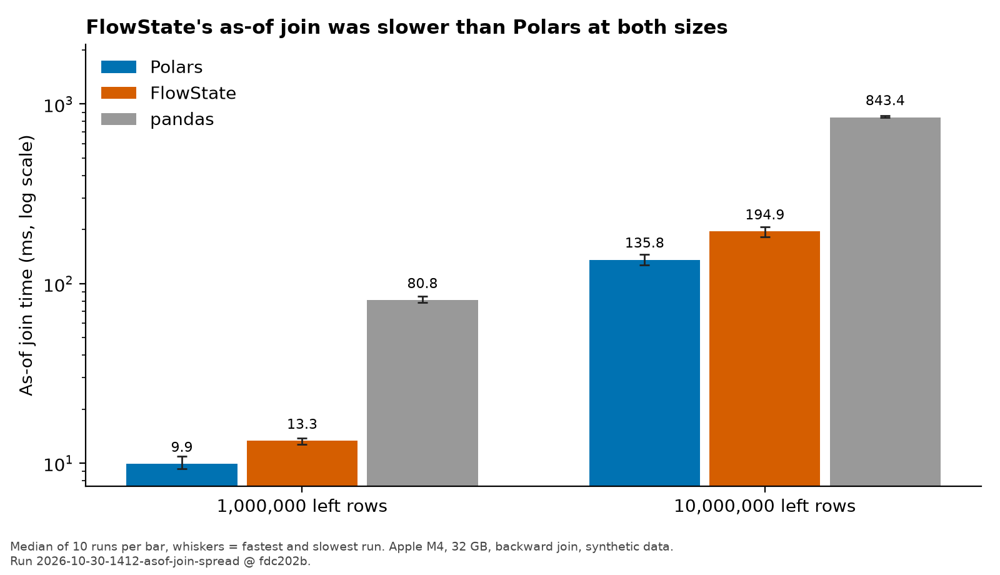

+++
title = "My Rust as-of join is slower than Polars"
date = 2026-10-30
description = "A Rust as-of join I claimed was faster than Polars. A reproducible benchmark showed the opposite, and a rebuild of the March kernel did not bring the lead back."
tags = ["rust", "arrow", "performance"]
draft = false
+++

**TL;DR.** In March 2026 I published a README table saying my Rust as-of join, FlowState, was 1.8 times faster than Polars (10 ms against 18 ms)[^readme_march_claim]. When I wrote a reproducible benchmark in October, the result reversed: in my runs on one Apple M4 laptop FlowState's median was 13.3 ms against 9.9 ms for Polars on 1M left rows[^asof_fs_1m][^asof_polars_1m], and 194.9 ms against 135.8 ms on 10M left rows[^asof_fs_10m][^asof_polars_10m]. I removed the March claim. Rebuilding the March kernel did not bring the lead back[^asof_march_build], and I do not know why Polars is faster or what produced the original number.

**Why this matters.** A performance claim with no captured run behind it can sit in a README for months. On this workload the library was faster in batch mode, so anyone considering a custom join kernel for point-in-time ML features should measure against the library first.

## What I believed

I believed FlowState would beat Polars on grouped as-of joins, and I wrote down why in the design doc on 2026-03-11: it skips the sort verification a general engine has to do, borrows symbol keys without allocating, joins symbol groups in parallel with Rayon, and splits large scans into parallel chunks[^design_doc_claim]. I also believed pandas "falls over at 10M rows."

## What I did

The March README table was never backed by a captured run[^readme_march_claim]. On 2026-10-04 I wrote a reproducible benchmark that prints the hardware, versions and dataset, and checks every engine's output against Polars before timing. I ran it through `pow run`. The first result showed Polars about 1.4 times faster, and pandas finished the 10M-row join in 0.76 s, so the pandas belief was also wrong[^journal_not_reproduced]. I removed the March claim from the README. On 2026-10-30 I added the fastest and slowest run to the output and captured 10 runs[^asof_setup].

DuckDB's `ASOF JOIN` did not finish at 1M rows and 1K symbols in my run, so it is opt-in in the script and not in the results here.

FlowState's batch kernel is a merge-scan over timestamp-sorted inputs, parallelized with Rayon, exchanging data with Python as Arrow without copying. The benchmark times only the join: data generation, sorting and table construction are excluded.

## What happened



*Figure: median as-of join time, 10 runs per bar, whiskers are the fastest and slowest run. Apple M4, 32 GB. Run 2026-10-30-1412-asof-join-spread @ fdc202b. Generated by `figure.py` from the capture's `output.log`.*[^asof_setup]

I measured the join on 1M left and 0.5M right rows, and on 10M left and 5M right rows, with 1,000 symbols each. Each figure is the median of 10 runs after 2 warmup runs, with the fastest and slowest run alongside.[^asof_setup]

| Engine | 1M left rows: median (min–max) | 10M left rows: median (min–max) |
|---|---|---|
| Polars | 9.9 ms (9.3–10.9)[^asof_polars_1m] | 135.8 ms (127.2–145.3)[^asof_polars_10m] |
| FlowState | 13.3 ms (12.7–13.8)[^asof_fs_1m] | 194.9 ms (182.7–206.2)[^asof_fs_10m] |
| pandas | 80.8 ms (78.7–84.9)[^asof_pandas_1m] | 843.4 ms (838.0–858.9)[^asof_pandas_10m] |

FlowState's median was 1.34 times Polars' at 1M rows[^asof_ratio_1m] and 1.44 times at 10M rows[^asof_ratio_10m]. In both sizes the ranges do not overlap: Polars' slowest run was faster than FlowState's fastest. FlowState was still well ahead of pandas.

An earlier capture on 2026-10-04, median of 5 runs with no spread recorded, shows the same ordering: 8.7 ms for Polars and 12.3 ms for FlowState at 1M rows[^asof_earlier_capture]. The absolute times drifted between the two sessions (Polars went from 8.7 ms to 9.9 ms on identical code and data), so I only compare engines within the same run.

## Why it failed

- **Measured cause:** none. I have not profiled either engine, and I have not tested whether any of the five reasons in my design doc hold.
- **Why the March number did not reproduce:** my journal suspected a stale March build of the Rust kernel or a different dataset[^journal_not_reproduced]. I tested the first guess. I built the kernel and Python package at the commit that carried the claim (`3c7486a`) and ran today's script against it with the same pinned libraries. FlowState was still slower: median 12.9 ms against 8.9 ms for Polars on 1M left rows[^asof_march_build], 1.45 times Polars' median with non-overlapping ranges[^asof_march_ratio]. A stale kernel does not explain the March figure.
- **Still untested (speculation):** a different dataset, and a Polars release in March that was slower than 1.38.1. The March table says only "Polars 1.x" and "Apple M-series"[^readme_march_claim], and I have no record of how its numbers were produced. Today's script and Rust toolchain are not the ones I used in March.
- **Why Polars is faster today:** I don't know.
- **What I'd test next:** profile both engines on this workload, and run the same data against older Polars releases.

## What I'd do instead

My view, from the README: FlowState's value is not raw join speed against Polars. It is the pieces around the join: watermark streaming alignment, the SPSC streaming pipeline, partitioned replay and the temporal feature store. That is an opinion, and this benchmark does not test it.

## Limits of this result

- **What I didn't test:** other CPUs, inputs that are not already globally timestamp-sorted, real market data, a join tolerance, thread-count settings, and memory use. I recorded no energy or power data.
- **Threats to validity:** one laptop with no recorded power or thermal state; synthetic random-walk quotes; two sessions that disagree on absolute time.

## Spec

<details>
<summary>Full benchmark specification</summary>

### Hardware
Apple M4, 10 logical cores, 32 GB RAM, macOS 26.6.2 (arm64). Power and thermal state: not recorded.[^asof_setup]

### Software
Python 3.14.3; FlowState 0.1.0 with the Rust kernel (rustc 1.94.0); Polars 1.38.1; pandas 3.0.6; DuckDB 1.5.0 (not run); pyarrow 23.0.1.[^asof_setup]

### Workload
Backward as-of join, no tolerance. Synthetic random-walk quotes, 1,000 symbols, seeds 42 and 99, globally timestamp-sorted. Sizes: 1M left and 0.5M right rows; 10M left and 5M right rows. Data generation excluded from timing.[^asof_setup]

### Metrics definitions
Wall time of one join call in milliseconds, from a monotonic clock. Median across timed runs, with the fastest and slowest.

### Energy method
n/a (not measured).

### Cost inputs
n/a.

### Statistics
10 timed runs after 2 warmup runs per engine and size, single session. No confidence interval computed.[^asof_setup]

Machine-readable: `results/2026-10-30-1412-asof-join-spread/` (`cmd.txt`, `env.txt`, `output.log`) @ `fdc202b`.
</details>

## What's open

Whether the March figure came from a different dataset or an older, slower Polars release. I do not have the March run, so I may not be able to settle it.

## Reproduce

```bash
git clone https://github.com/RyanJHamby/FlowState && cd FlowState
git checkout fdc202b
uv venv --python /opt/homebrew/bin/python3.14 .venv && . .venv/bin/activate
uv pip install maturin numpy polars==1.38.1 pandas==3.0.6 pyarrow==23.0.1
(cd flowstate-core && maturin develop --release)
uv pip install -e .
python -W ignore benchmarks/reproduce.py --pandas-scale --runs 10
```

Use a regular CPython 3.14 build. A free-threaded 3.14 build failed to install Polars 1.38.1 in my attempt[^asof_clean_rerun]. I ran these commands from a fresh clone and the ordering held, with Polars' slowest run faster than FlowState's fastest at both sizes[^asof_clean_rerun]. The raw log is `repro-clean-env.log` in the post's draft folder.

Approximate cost to reproduce: about 1.5 minutes on the M4, including the Rust build, and no cloud spend[^repro_time].

## References

[1] FlowState repository, `benchmarks/reproduce.py` and `results/` at commit `fdc202b`.

---
**Reproduce:** https://github.com/RyanJHamby/FlowState at `fdc202b` · **Raw data:** `results/2026-10-30-1412-asof-join-spread/` at that commit; the March-build test is `results/2026-10-30-1423-asof-join-march-build-3c7486a/` at `53084c2`
**Published:** 2026-10-30 · **Last updated:** 2026-10-30 · [Changelog](#changelog)
**AI disclosure:** Drafted with AI (Claude) from my captured runs and from notes I wrote in the FlowState README, design doc and journal. The benchmarks were run on my machine through an AI assistant at my direction, and every number comes from a captured run or a cited file in that repo. Claim-by-claim verification is not recorded yet.
**Corrections:** If something here is wrong, email ryan.j.hamby@gmail.com. I fix errors publicly in the changelog.

## Changelog

- **2026-10-30:** Published. Results at FlowState `fdc202b` and `53084c2`.

[^readme_march_claim]: The 2026-03-11 FlowState README table listed a grouped as-of join (1M rows, 1K symbols, 'Apple M-series', Polars 1.x) at 10 ms for FlowState against 18 ms for Polars, labelled 1.8x. It cited no captured run. Source: FlowState repo, README.md at commit 3c7486a, lines 56-61 (git show 3c7486a:README.md).
[^asof_fs_1m]: FlowState as-of join, same data: median 13.3 ms (min 12.7, max 13.8) Source: results/2026-10-30-1412-asof-join-spread/output.log.
[^asof_polars_1m]: Polars as-of join, 1,000,000 left x 500,000 right rows: median 9.9 ms (min 9.3, max 10.9), 10 runs after 2 warmup Source: results/2026-10-30-1412-asof-join-spread/output.log.
[^asof_fs_10m]: FlowState, same data: median 194.9 ms (min 182.7, max 206.2) Source: results/2026-10-30-1412-asof-join-spread/output.log.
[^asof_polars_10m]: Polars, 10,000,000 left x 5,000,000 right rows: median 135.8 ms (min 127.2, max 145.3) Source: results/2026-10-30-1412-asof-join-spread/output.log.
[^asof_march_build]: Kernel and Python package built at commit 3c7486a (the 2026-03-11 README that claimed 1.8x), today's reproduce.py, same Apple M4, Python 3.14.3, polars 1.38.1, pandas 3.0.6, pyarrow 23.0.1, release build, 10 runs after 2 warmup, 1M left x 500K right rows, 1,000 symbols: FlowState median 12.9 ms (min 11.8, max 13.6) against Polars 8.9 ms (min 8.5, max 9.7). Source: FlowState results/2026-10-30-1423-asof-join-march-build-3c7486a/output.log @ 53084c2.
[^design_doc_claim]: DESIGN.md section 3.2, 'Why we outperform Polars', written 2026-03-11 and still present in the repo, argues FlowState is faster on grouped temporal joins and lists five reasons. Source: FlowState repo, DESIGN.md line 78 at 3c7486a and at main.
[^journal_not_reproduced]: Journal 2026-10-04 17:29: 'The earlier README claim of 1.8x over Polars did not reproduce and was removed. Suspect the earlier number came from a stale (March) flowstate_core build or a different dataset; not verified.' Source: FlowState repo, docs/journal.md, entry 2026-10-04 17:29 (at 0df6f05).
[^asof_setup]: Apple M4, 10 logical cores, 32 GB; Python 3.14.3; polars 1.38.1, pandas 3.0.6, pyarrow 23.0.1; flowstate 0.1.0 with Rust kernel; backward join, no tolerance; synthetic random-walk quotes, 1,000 symbols, seeds 42 and 99; data generation excluded Source: results/2026-10-30-1412-asof-join-spread/output.log and env.txt.
[^asof_pandas_1m]: pandas as-of join, same data: median 80.8 ms (min 78.7, max 84.9) Source: results/2026-10-30-1412-asof-join-spread/output.log.
[^asof_pandas_10m]: pandas, same data: median 843.4 ms (min 838.0, max 858.9) Source: results/2026-10-30-1412-asof-join-spread/output.log.
[^asof_ratio_1m]: FlowState median / Polars median = 1.34 at 1M rows; ranges do not overlap (Polars max 10.9 ms < FlowState min 12.7 ms). Derived by derive.py. Source: drafts/flowstate-asof-join/derive.py on the output.log above.
[^asof_ratio_10m]: FlowState median / Polars median = 1.44 at 10M rows; ranges do not overlap (Polars max 145.3 ms < FlowState min 182.7 ms). Derived by derive.py. Source: drafts/flowstate-asof-join/derive.py on the output.log above.
[^asof_earlier_capture]: Earlier capture, 2026-10-04, median of 5 runs, no spread recorded: Polars 8.7 ms, FlowState 12.3 ms at 1M rows; Polars 128.7 ms, FlowState 182.1 ms at 10M rows Source: results/2026-10-04-1729-asof-join-vs-polars-pandas/output.log.
[^asof_march_ratio]: FlowState median / Polars median = 1.45 for the March build; ranges do not overlap (Polars max 9.7 ms < FlowState min 11.8 ms). Derived by derive.py. The March kernel was built with today's Rust toolchain and the script is today's, not March's. Source: drafts/flowstate-asof-join/derive.py on the log above.
[^asof_clean_rerun]: Clean-environment rerun (fresh clone at fdc202b, uv venv, regular CPython 3.14.3, polars 1.38.1, pandas 3.0.6, pyarrow 23.0.1, maturin develop --release): same ordering, and Polars' slowest run was faster than FlowState's fastest at both sizes. A free-threaded CPython 3.14.7 failed to install Polars 1.38.1. This was not a pow run capture, so the rerun's own timings are not quoted. Source: drafts/flowstate-asof-join/repro-clean-env.log and repro-clean-env.sh.
[^repro_time]: About 1.5 minutes end to end on the M4 for the clean setup, Rust build and benchmark, from the elapsed time in the clean-environment log (1:28.90). No cloud cost. Source: drafts/flowstate-asof-join/repro-clean-env.log (last lines).
