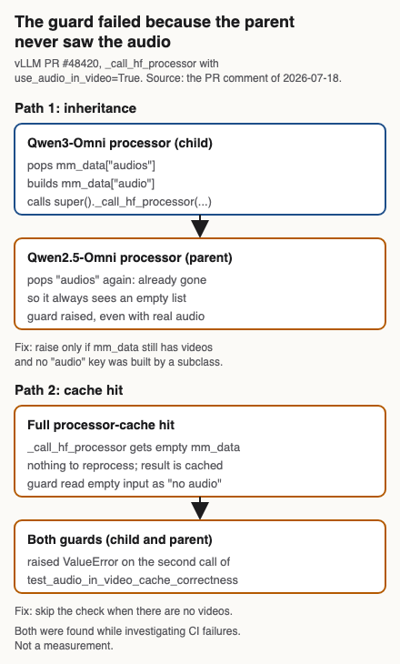

+++
title = "The fix for a Qwen3-Omni crash broke CI two ways before it merged"
date = 2026-10-31
description = "A reported Qwen3-Omni crash on videos with no audio track: my first fix, the review that replaced it, and the two CI failures the new guard caused."
tags = ["vllm", "multimodal", "qwen3-omni", "build-log"]
draft = true
+++

**TL;DR.** A vLLM user reported that Qwen3-Omni crashes on a video with no audio track when `use_audio_in_video=True`[^pr_shape]. My first fix silently fell back to `use_audio_in_video=False`. A maintainer's review asked for a clear `ValueError` instead, and a maintainer's cleanup commit then put the same check in the shared parent class. There it failed an existing cache-correctness test in CI, on two paths: the parent never sees the audio, and a cache hit arrives with empty input. The merged change touches 3 files[^pr_diff].

**Why this matters.** If you subclass a multimodal processor and add a check in `_call_hf_processor`, the same two paths apply to you. Both only showed up in CI.

## What I believed

The PR body argues that when no audio is extracted there is "nothing to interleave", so passing the flag on only turns a usable result into a crash[^pr_body_fallback]. I did not see the downside myself. The reviewer raised it: a silent fallback hands the caller output that is not audio-in-video output, with no sign of that[^review_comment].

## What I did

I came to this by scanning multimodal code for attributes that go missing on edge cases. An AI assistant traced the cause: the Hugging Face `Qwen3OmniMoeProcessor` calls `next(audio_lengths)` on an exhausted iterator and raises a bare `StopIteration` at line 247[^pr_traceback]. I confirmed the trace by reproducing it with a synthetic no-audio video of the reported shape (16, 3, 480, 256)[^pr_shape]. vLLM wraps that in a generic `ValueError`, which is what the reporter saw.

After review I replaced the fallback with an explicit error in the Qwen3-Omni class[^commit_authors]. A maintainer's cleanup commit then added a check to the shared Qwen2.5-Omni parent class as well[^commit_7166]. That is where CI failed.

## What happened

A fresh-environment rerun on 2026-10-31, run by the AI assistant that helped draft this post, used transformers 5.22.1. `use_audio_in_video=True` raised the same `StopIteration`, now at line 249[^repro_line]. The same call with `use_audio_in_video=False` returned normal outputs. The line differs from the one in the PR, which does not state its transformers version; the behavior is the same.



*Figure: why the guard raised on real audio and on cache hits. Redrawn from the author's PR comment of 2026-07-18, not a measurement. Generated by `figure.py`.*

CI then failed, for real errors and not flakes. I investigated the failing jobs, reproduced them locally on a CPU build, and found two false positives:

- **The parent never sees the audio.** The Qwen3-Omni processor pops `mm_data["audios"]`, builds `mm_data["audio"]`, and calls the Qwen2.5-Omni parent. The parent pops `"audios"` again, finds nothing, and raised even when real audio was present.
- **A cache hit has no input.** On a full multimodal-processor-cache hit, `_call_hf_processor` receives an empty `mm_data`. Both guards read that as "no audio track".

A third problem was already there: an `assert "audio" in mm_counts` fired whenever the audio limit was zero, whether or not the video lacked audio. It became the same clear error.

An AI wrote the second fix, which I reviewed and tested. The final guards require unconsumed video data and no `"audio"` key already present. I reported 6 tests passing locally on a CPU build across both models[^pr_tests]. That count is from the PR thread, and I did not rerun vLLM's tests for this post.

## Why it failed

The first approach failed on review, not on a test. In my opinion the reviewer was right: a request for audio-in-video that quietly becomes video-only gives the caller a wrong result with no signal, and an error is cheaper to act on than a wrong answer.

The two guard failures showed up in CI. My explanation, labeled as such: one method is entered in three different ways, directly, through `super()` from a subclass that has already consumed part of its input, and on a cache hit that has no input at all. A check written for the first way is wrong for the other two. I did not test whether other processors in the same family share the parent and have the same two paths.

## What I'd do instead

This is opinion, and untested beyond this one fix.

- **Test every way a method is entered.** For a method that subclasses override and that a cache can bypass, write a case for the direct call, the call through `super()`, and the empty-input cache hit. Here the existing cache-correctness test caught both failures, which is the argument for keeping such tests in CI.
- **Keep an edge-case input set for the whole model family.** A video with no audio, a silent audio track, and an empty input, run against every processor that shares the base class. I have not built this.
- **Make consumption explicit.** When a subclass removes a key before delegating, say so in the signature or a short assertion at the boundary. A lint rule that flags the same key popped twice in an override chain is possible; I have not written one.

## Limits of this result

- **What I didn't test:** other processors, any transformers version but the one in the repro log[^repro_line], and vLLM's test suite itself.
- **Could this work elsewhere?** I did not test any other setting.
- **Open question:** which other processors share the Qwen2.5-Omni parent, and do they have the same two paths?

## Reproduce

```bash
uv venv --python 3.12 .venv
uv pip install --python .venv/bin/python transformers==5.22.1 numpy torch torchvision
.venv/bin/python repro.py
```

`repro.py` and its log are in the draft folder. The log records versions and the line where `StopIteration` is raised.

## References

[1] vLLM issue 48383: https://github.com/vllm-project/vllm/issues/48383
[2] vLLM PR 48420: https://github.com/vllm-project/vllm/pull/48420

---
**Reproduce:** site repo `drafts/qwen3-omni-no-audio-track` · **Raw data:** `repro-clean-env.log`
**Published:** 2026-10-31 · **Last updated:** 2026-10-31 · [Changelog](CHANGELOG.md)
**AI disclosure:** I did the reproduction, the first fix and the CI investigation. An AI assistant traced the root cause (I confirmed it) and wrote the second fix (I reviewed and tested it). The post was drafted with AI from the public PR record, and the AI wrote the reasoning and recommendations in the two opinion sections at my direction. The rerun log was produced by the AI.
**Corrections:** If something here is wrong, email ryan.j.hamby@gmail.com. I fix errors publicly in the changelog.

[^pr_shape]: Reported video shape (16, 3, 480, 256), uint8 Source: https://github.com/vllm-project/vllm/issues/48383 (traceback in body), read 2026-10-31.
[^pr_diff]: Merged diff: 3 files changed, 57 additions, 1 deletion (32+18+7 additions) Source: gh pr view 48420 -R vllm-project/vllm --json files, read 2026-10-31; merged 2026-08-03.
[^pr_body_fallback]: The PR body's stated reason for the first fix: when no audio was extracted but use_audio_in_video=True was requested, fall back to False because there is nothing to interleave Source: https://github.com/vllm-project/vllm/pull/48420 (body, 'Fix' section), read 2026-10-31; re-read 2026-10-31 in the verification pass.
[^review_comment]: The maintainer's inline review comment preferred raising a ValueError over silently falling back to use_audio_in_video=False, because a user may treat the output as audio-in-video output Source: https://github.com/vllm-project/vllm/pull/48420, inline review comment on vllm/model_executor/models/qwen3_omni_moe_thinker.py, read 2026-10-31 via the PR page. Commit f25d0ca message: 'Per the reviewer's review, silently falling back ... could mislead the caller into thinking audio-in-video was applied when it wasn't.'.
[^pr_traceback]: PR #48420 body reports the StopIteration at processing_qwen3_omni_moe.py line 247, np.arange(next(audio_lengths)) Source: https://github.com/vllm-project/vllm/pull/48420 (body), read 2026-10-31. transformers version at the time is not stated in the PR..
[^commit_authors]: f25d0ca (raise ValueError instead of fallback) and 2d8f7ee (fix false positives) are authored by RyanJHamby; 7166e20 ('clean') is authored by a maintainer Source: gh pr view 48420 -R vllm-project/vllm --json commits, read 2026-10-31.
[^commit_7166]: 7166e20 added a guard branch to _call_hf_processor in qwen2_5_omni_thinker.py (the shared parent class): elif mm_kwargs.get('use_audio_in_video'): raise ValueError(...), and moved the no-audio test into test_audio_in_video.py Source: https://github.com/vllm-project/vllm/commit/7166e20, read 2026-10-31. Author's own PR comment of 2026-07-18 says the parent guard was added in 7166e20..
[^repro_line]: Clean-environment repro: same StopIteration at line 249 of processing_qwen3_omni_moe.py with transformers 5.22.1, use_audio_in_video=True; use_audio_in_video=False succeeds. macOS arm64, CPU, Python 3.12.12, numpy 2.5.4, torch 2.15.0. Processor loaded from Qwen/Qwen3-Omni-30B-A3B-Instruct (processor files only, no model weights). The PR reports line 247; the PR does not state a transformers version, so the cause of the 2-line difference is unknown. Source: drafts/qwen3-omni-no-audio-track/repro-clean-env.log, produced by repro.py, 2026-10-31. Not a pow run capture; no timings are quoted..
[^pr_tests]: Author's comment of 2026-07-18: after pushing 2d8f7ee, all 6 tests in test_audio_in_video.py pass locally on a CPU build (both models, new and existing tests) Source: https://github.com/vllm-project/vllm/pull/48420 (comment 2026-07-18). Self-reported; I did not rerun vLLM's test suite..
