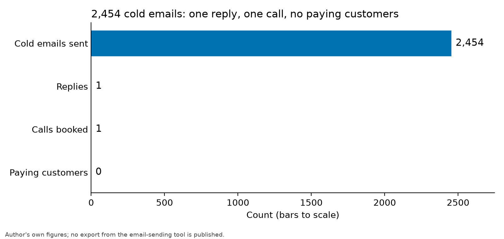

+++
title = "Why I paused the site-control checker I built for PJM's interconnection queue"
date = 2026-11-13
description = "Why I paused Zonevex, software that checked site control against interconnection-queue rules: the outreach result, PJM's own AI review tool, and what I would build instead."
tags = ["zonevex", "postmortem", "interconnection"]
draft = false
+++

**TL;DR.** I built Zonevex, software that checks whether a developer's site control would hold up against an RTO's interconnection-queue rules. It got no paying customers: 2,454 cold emails produced one reply and one booked call[^outreach]. I paused it in November. Two reasons: PJM, the RTO my free toolkits were built for, was already using an AI tool from Tapestry to review application documents[^pjm_release_hyperq], and I never found a channel to the people who buy this kind of software. The first is documented. The second is my judgment, not a measurement.

**Why this matters.** It cost me about 150 hours and $185 to find out[^cost]. If you are thinking about compliance software for grid and power, the engineering is the part you can control, and it is the part I got furthest on.

*As of 2026-11-13.*

## What I believed

I framed Zonevex from the start as a time-capped bet on distribution, not a product bet, with a falsification gate set for October 2026. I already knew the buyers were slow: utilities and project developers tend to buy from vendors they have met, and enterprise cycles run long against a solo founder's runway.

## What I did

Zonevex took lease and easement PDFs. Claude Vision extracted the fields, a parser turned legal descriptions into geometry, PostGIS computed parcel coverage, and per-RTO rules held in a database table produced the report. The code stayed in a private repository: first commit 2026-02-21, last 2026-10-22[^repo_span]. Around it I built a marketing site, free PJM toolkits and 25 blog posts[^repo_blog_posts].

Work on the code stopped after June[^commits_by_month]. Three things overlapped over the summer: I decided to stop, other priorities took the time, and I was waiting on outreach.

The October commits were all between October 20 and 22 and were cleanup, not new product: removing prices from the public pages and the app, correcting claims in my HyperQ post, adding a PJM large-load post, fixing the web deploy workflow, and a first draft of a specification for an open interconnection rules register[^october_commits].

In October I tried something smaller than selling: short, sourced notes that told a developer where two public records disagreed about one of their projects. No pitch. I sent a few through company web forms to see whether anyone engaged.

## What happened

The outcome was thin. Only some people downloaded the free calculator and toolkits, mostly from private equity firms. One call was booked through Cal.com with a founder in the site-control field. I sent 2,454 cold emails, one person replied, and they said they did not need it[^outreach].

[^outreach]
*Outreach results, drawn to scale. My own figures.*

My read: one reply from that many emails says something about my targeting and message. It does not show that the market has no need.

PJM's reformed Cycle 1 required proof of site control, and 811 projects applied by the window's close on April 27[^pjm_release_811]. PJM said its staff were already using HyperQ, a tool from Google's Tapestry, to identify and assess sections of application documents for further review[^pjm_release_hyperq].

Tapestry's own account is more specific. HyperQ evaluates each bundle of agreements against four site-control elements: term, conveyance, exclusivity and minimum acreage[^tapestry_checks]. Everything here is vendor-reported. Tapestry says PJM's experts "retained full control over all final determinations"[^tapestry_determinations].

HyperQ was not available to developers when I checked. Tapestry lists developer pre-submission access as a future item with no date[^tapestry_dev_access]. That is a plan, not a product, and it points at the same ground I was working: telling a developer whether their site control will pass before they file.

## Why it failed

My best explanation, offered as opinion: the limit was distribution and procurement, not the product. New grid and power technology lacks trusted pilot and procurement channels, because of locked-down data, liability, long vendor cycles and busy decision-makers.

The second factor is documented but smaller than it sounds. A vendor aligned with the RTO's own reviewers covers the first-pass check. It does not, as far as I could tell, cover a developer's multi-RTO portfolio, land workflow or title work, so it narrows the opening rather than closing it. This is my judgment from reading the vendor page, not a test.

Measured cause: none. I have no data that separates "no demand" from "no channel to find it." What would separate them is a paid pilot offered through a channel I could actually reach, and I did not run one.

## What I'd do instead

I would start with point-in-time capture: engines that record the state of interconnection queues with dated timestamps, beginning with site control. And I would build them as open-source tooling first, not as business-to-business sales. That is my judgment, not a tested result.

## Limits of this result

- **What I didn't test:** a paid pilot, any RTO other than PJM as a first customer, and whether the free notes changed anyone's behavior.
- **Could this work elsewhere?** Yes, under conditions I wrote down when I paused it: a buyer need the incumbents will not serve, inbound interest with a budget or a pilot, a rule change that opens a wedge, or a distribution channel I can reach. Any one of those would change my answer.

**An open question.** Would a developer pay for a second opinion on site control from someone who is not the RTO's reviewer, and if so, who inside the company signs for it?

## References

[1] Tapestry, "Field notes: HyperQ deployment in PJM's Cycle 1," tapestryenergy.com/en/projects/field-notes-hyperq-deployment-in-pjm-s-cycle-1. Entries dated 2025-12-08 to 2026-11-10. Accessed 2026-11-13. Vendor-reported. Archived 2026-10-21, before the 2026-11-10 entry: web.archive.org/web/20261021195727/https://www.tapestryenergy.com/en/projects/field-notes-hyperq-deployment-in-pjm-s-cycle-1

[2] PJM Interconnection, news release "Over 800 New Generation Projects Seek To Connect Under PJM's Reformed Process," 2026-04-29. Accessed 2026-11-13. Archived 2026-07-03: web.archive.org/web/20260703040154/https://www.pjm.com/-/media/DotCom/about-pjm/newsroom/2026-releases/20260429-over-800-new-generation-projects-seek-to-connect-under-pjms-reformed-process.pdf

---
**Reproduce:** not applicable (a postmortem, not a benchmark). The counts come from a private repository. · **Raw data:** `results/2026-11-13-1729-zonevex-repo-stats/`, `results/2026-11-13-1729-zonevex-commits-by-month/` and `results/2026-11-13-1729-zonevex-october-commits/` in this site's repository; the outreach figures are mine and are in `drafts/zonevex-retrospective/outreach.csv`
**Published:** 2026-11-13 · **Last updated:** 2026-11-13 · [Changelog](#changelog)
**AI disclosure:** Drafted with AI from my notes, my answers to its questions, my repository records and two primary sources it read. The decisions and judgments are mine. Figures marked as estimates are my recollection.
**Corrections:** If something here is wrong, email ryan.j.hamby@gmail.com. I fix errors publicly in the changelog.

## Changelog

- **2026-11-13:** Published. Counts from runs captured the same day.
- **2026-11-13:** Replaced the chart of commits per month with the outreach results, and removed commit counts from the summary. Commit counts say little about effort or progress.

[^outreach]: 2,454 cold emails sent; one person replied and said they did not need the product; one call was booked through Cal.com with a founder in the site-control field. Free calculator and toolkit downloads were few and came mostly from private equity firms. Source: My own figures. I have not published an export from the email-sending tool or the Cal.com booking.
[^pjm_release_hyperq]: PJM said it is using HyperQ, an AI-enabled tool developed by Google's Tapestry, to help review large volumes of application data, and that HyperQ is already helping with these reviews. Source: Same PJM release, page 1, accessed 2026-11-13. Same archived copy.
[^cost]: About 150 hours of my time and $185 in cash to build and run Zonevex. Source: My own estimate. I kept no timesheet or receipt export for it.
[^repo_span]: First commit 2026-02-21; last commit before the pause 2026-10-22, on the same main branch. Source: results/2026-11-13-1729-zonevex-repo-stats/output.log. The repository is private.
[^repo_blog_posts]: 25 blog HTML files in the landing site's blog folder of the Zonevex repository. Source: results/2026-11-13-1729-zonevex-repo-stats/output.log. The repository is private.
[^commits_by_month]: Commits on the Zonevex main branch per month in 2026: February 148, March 199, April 44, May 338, June 100, July 0, August 0, September 0, October 7. They sum to 836. November's commits record the pause and are excluded. Source: results/2026-11-13-1729-zonevex-commits-by-month/output.log (command in cmd.txt, hardware in env.txt: Apple M4, 10 cores, 32 GB). The repository is private.
[^october_commits]: The seven October 2026 commits all fall between 2026-10-20 and 2026-10-22: removing prices from the landing pages and the web app, excluding internal files from site deploys, correcting claims in a HyperQ post, adding a PJM large-load post, fixing the web deploy workflow, adding a specification for an open interconnection rules register, and adding engineering-journal scaffolding. Source: results/2026-11-13-1729-zonevex-october-commits/output.log (commit subjects). The repository is private.
[^pjm_release_811]: 811 generation projects applied to PJM's first Cycle 1 under the reformed process; the application window closed on 2026-04-27; the process requires proof of site control. Source: PJM Interconnection news release 'Over 800 New Generation Projects Seek To Connect Under PJM's Reformed Process', 2026-04-29, pages 1 to 2, accessed 2026-11-13. Archived 2026-07-03 at web.archive.org/web/20260703040154/https://www.pjm.com/-/media/DotCom/about-pjm/newsroom/2026-releases/20260429-over-800-new-generation-projects-seek-to-connect-under-pjms-reformed-process.pdf.
[^tapestry_checks]: Tapestry says HyperQ evaluates each bundled agreement against four OATT site-control elements: term, conveyance, exclusivity and minimum acreage. This is vendor-reported. Source: Tapestry, 'Field notes: HyperQ deployment in PJM's Cycle 1', tapestryenergy.com/en/projects/field-notes-hyperq-deployment-in-pjm-s-cycle-1, entries dated 2025-12-08 to 2026-11-10, accessed 2026-11-13. Archived 2026-10-21, before the 2026-11-10 entry, at web.archive.org/web/20261021195727/https://www.tapestryenergy.com/en/projects/field-notes-hyperq-deployment-in-pjm-s-cycle-1.
[^tapestry_determinations]: Tapestry's page states that 'PJM experts retained full control over all final determinations'. This is vendor-reported. Source: Same Tapestry page, footnote to the 2026-04-29 entry, accessed 2026-11-13. Same archived copy.
[^tapestry_dev_access]: Tapestry's page does not say developers can use HyperQ today. It lists developer pre-submission access as a future item with no date. This is vendor-reported. Source: Same Tapestry page, 'Looking ahead' section, as of the entry dated 2026-11-10, checked 2026-11-13. A claim about what a page does not say can change; the archived copy predates the 2026-11-10 entry.
